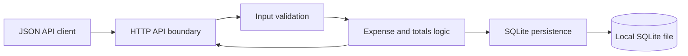
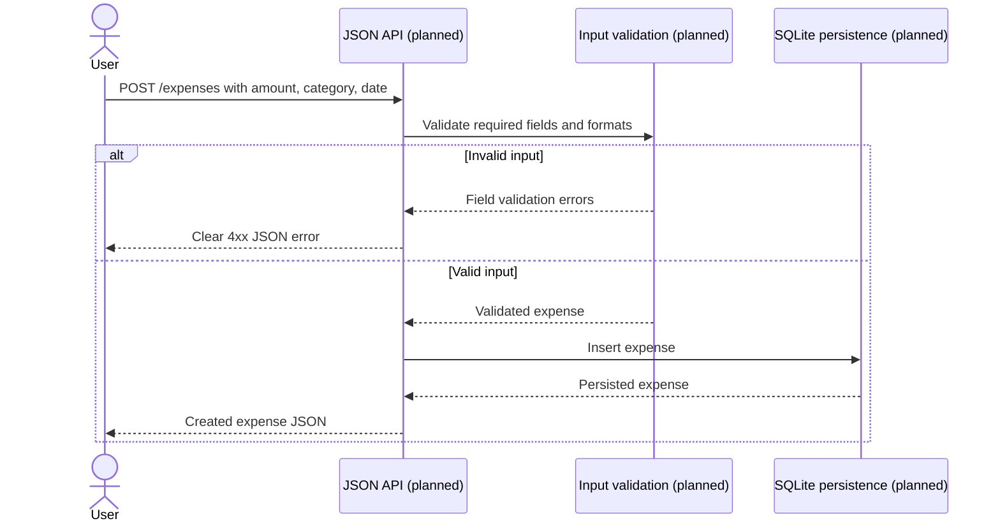
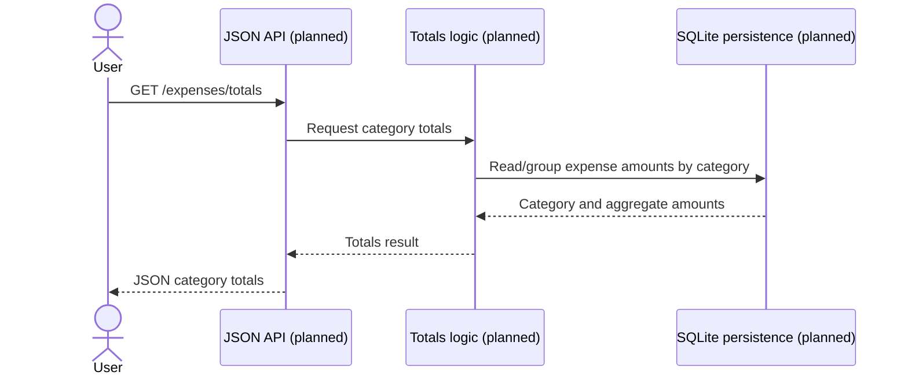

# Architecture Analysis

## System Overview

The repository contains only a minimal Python entry-point scaffold and Python project metadata. No expense-tracking architecture or runtime components are implemented. The intended shape, inferred from the intent rather than observed code, is one modular monolith exposing a JSON API, validating requests, applying expense and aggregation logic, and persisting records to a local SQLite file.

## Architectural Style

**Current:** Single-process Python scaffold; no web framework or layered architecture is present (`main.py`).

**Intended:** One modular monolith with an HTTP/API boundary, domain/application logic, and a SQLite persistence boundary. Avoid separate services and operational infrastructure, consistent with the intent.

## Component Relationships

The following flow is a proposed target, not a description of implemented components:

Text fallback: the client calls the planned HTTP API; the API validates inputs, delegates to expense/totals logic, and reads or writes through SQLite persistence to a local database file. Results or validation errors return through the API. None of these components exists in the current source.

## Data Flow

- **Create (intended):** JSON input → parse and validate amount/category/date → persist a valid expense → return the created representation.
- **Totals (intended):** request → query persisted expenses and group/sum by category → serialize JSON totals.
- **Observed today:** running the module invokes `main()` and prints `Hello from metric!`; no business data is processed.

## Key Design Decisions and Trade-offs

1. **Persistence — file-based SQLite (intent decision).** It supplies durable local storage without a database server and supports straightforward aggregation. An in-memory store would simplify setup but lose data across restarts and is not the intent's selected default. A remote database would add deployment and operational scope without a stated need.
2. **Single modular monolith (intent decision).** It keeps the simple local service in one deployable application. Separate services could isolate responsibilities but would add network boundaries, operational overhead, and complexity contrary to scope.
3. **HTTP framework — undecided.** No framework is present and the intent does not mandate one. A small established Python JSON framework could reduce routing/serialization work; the standard library would reduce dependencies but require more HTTP plumbing. Select the simplest maintained option compatible with the actual implementation plan.
4. **Amount representation — assumption.** Use integer minor units or a decimal representation for storage and summation to avoid binary floating-point rounding. Currency and decimal precision are not specified and should not be silently implied by API documentation.

### Security and Compliance

The intended service has no authentication by explicit decision and has only one tenant. Since expense data may be sensitive, bind to a local/trusted interface by default, avoid logging request contents unnecessarily, and do not imply multi-user isolation. No regulatory or compliance requirements are specified. SQLite file permissions and backup/retention behavior remain deployment decisions.

## Improvement Opportunities

- Replace the greeting scaffold with the smallest coherent API, validation, persistence, and category-total path.
- Define the amount/currency representation and API response/error schema before implementation.
- Add isolated pytest tests for valid creation, invalid fields, and totals across repeated categories.
- Document how to configure the SQLite file path and run the API/tests locally.

## Interaction Diagrams

These diagrams describe the intent-level target transaction flows; no corresponding handlers, services, or repository code are implemented yet.

### Create an Expense (Proposed)

Text fallback: the planned create request is validated before persistence. Invalid fields produce a clear client error without writing data; valid input is inserted into SQLite and returned as JSON. This is a proposed flow only.

### Retrieve Category Totals (Proposed)

Text fallback: the planned totals endpoint obtains stored expenses, groups and sums amounts by category, then returns the totals as JSON. No filtering or date range is implied.
